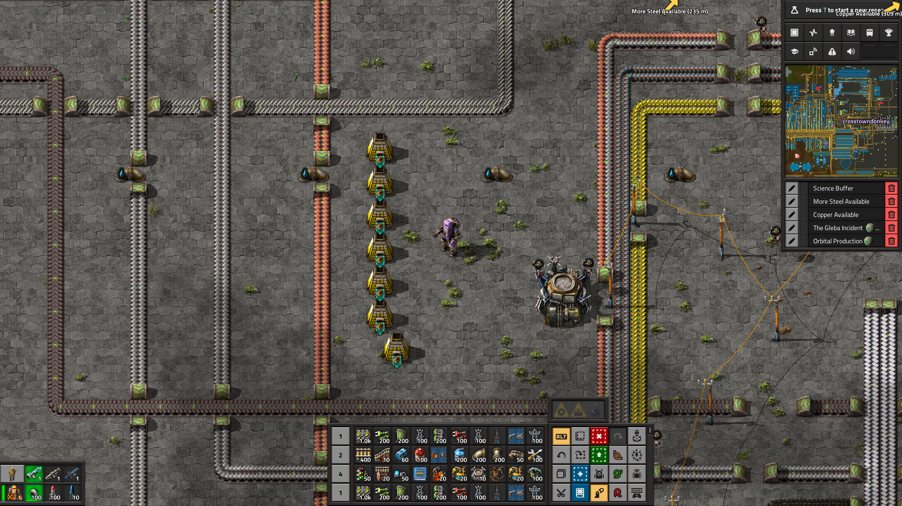

# Smart Fuel (Factorio 2.1 mod)



Everything that burns fuel keeps itself fuelled - furnaces, boilers, burner drills and inserters, locomotives, cars,
tanks, nuclear reactors, biochambers, heating towers (optional) and modded burners. Construction robots bring the fuel
from the logistic network; on space platforms the hub throws it across. No chests, no extra buildings.

## Which fuel
| Machine | Fuel |
|---|---|
| Locomotives, cars, tanks | The **best** fuel: biggest speed + acceleration bonus (nuclear > rocket > solid > coal). Worse fuel is swapped out while the vehicle stands still. |
| Furnaces, boilers, burner drills and inserters | The **most plentiful basic fuel** (coal, wood, carbon...). Solid fuel only when there is no basic fuel. Never rocket or nuclear fuel (an editable list). |
| Nuclear reactors | A few fuel cells (2 by default); used-up cells are carried away. |
| Biochambers | A small amount of nutrients (20 by default), because they spoil. |
| Heating towers | Like furnaces - **off by default**, because they burn about 40 MW. |

- **Pick the fuel yourself:** open a machine or locomotive and use the **Fuel** panel beside its window. A picked fuel is
  the only one used (it may even be rocket fuel in a furnace - a deliberate pick is allowed). Copy / paste settings
  copies the choice, and blueprints remember it.
- Machines that inserters keep full never run low, so the mod never touches them.
- Fuel the player put in by hand that the rules wouldn't choose is left alone.

## Settings (map settings)
| Setting | Default |
|---|---|
| Fill to (% of a stack) | 100 |
| Refill when below (% of the amount filled) | 25 |
| Swap worse fuel for better fuel in vehicles | on |
| Fuels never put in machines | rocket-fuel, nuclear-fuel |
| Fuels never used at all | (empty) |
| Fuel nuclear reactors / cells to keep | on / 2 |
| Feed biochambers / nutrients to keep | on / 20 |
| Fuel heating towers | off |
| Take away used-up fuel | on |
| Machines checked per tick | 20 |

## For other mods
```lua
remote.call("smart-fuel", "set_fuel", entity, "rocket-fuel", "normal") -- pick the fuel for one machine
remote.call("smart-fuel", "set_fuel", entity, nil)                     -- back to automatic
remote.call("smart-fuel", "kind", entity) -- "vehicle", "stationary", "reactor", "nutrients", "heater" or nil
```

## Development
- `tools/run_tests.sh` - runs the test harness (`tests/sf-tests`, 17 checks) headless in a throwaway folder on a
  fixed, enemy-free map. It never touches `~/.factorio`.
- `tools/package.sh` - builds `dist/smart-fuel_<version>.zip`.
- `tools/publish.py [--first]` - publishes on the mod portal (API key in `~/.config/factorio/modportal-api-key`).

## License
MIT - see [LICENSE](LICENSE).
